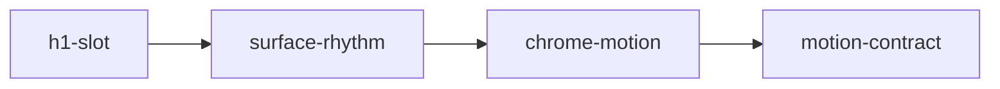

# Motion editorial del sitio

Fases de este método: mapa de capacidades, spec, plan de tareas. El código y los ficheros `tasks/plan.md` y `tasks/todo.md` no existen todavía y no se crean hasta cerrar las rondas y aprobar el spec resultante.

## Rondas de validación

Las cinco rondas están cerradas. Lo que sigue es el contrato. Una pieza descartada no se construye: el configurador de precio queda fuera.

### Ronda 1 — Qué entra y cómo se lee el titular

Estado: cerrada.

Decisión: se incorporan los cuatro módulos (`h1-slot`, `surface-rhythm`, `chrome-motion`, `motion-contract`). El arranque «Aquí se crean productos digitales que son reflejo de» se conserva y las tres frases ocupan la ventana. Ninguna tarea se cancela.

### Ronda 2 — Cómo se escribe la ventana

Estado: cerrada.

Decisión: el orden es el propuesto. La primera frase, visible al cargar, es «personalidad individual y reputación profesional»; luego «proyectos empresariales e iniciativas sociales»; luego «cualidades humanas de alto valor». Arranque y frases van en minúscula de frase, sin punto final. El color de la frase activa se decide en la ronda 3.

### Ronda 3 — Cómo se mueve

Estado: cerrada.

Decisión: reposo de 4 s y giro de 550 ms. La frase en reposo usa `--brand`. La pausa es un checkbox visible con el rótulo «¡Pare las rotativas!», y el ciclo también se detiene al pasar el cursor o al enfocar. Con menos movimiento, las tres frases siguen en columna y el control no se muestra.

### Ronda 4 — Qué más se mueve en el sitio

Estado: cerrada.

Decisión: entran valores y metodología (filete `--brand`, elevación de 4 px y reveal), el reveal de servicios, precios estáticos, sectores y publicaciones, la regla de portada, la entrada del menú móvil y el motivo quieto de la 404. No entra el micro-movimiento del configurador de precio: la tarea 8 se cancela. Las páginas legales siguen sin reveal.

### Ronda 5 — Qué queda escrito

Estado: cerrada.

Decisión: se escriben los tres artefactos. La demo de `/design-system` incluye el estado de menos movimiento y un botón para repetir el giro, del mismo modo que la entrada del hero. También entran el párrafo de uso en `diseno.md` (la ventana solo vive en el H1 de la home) y la decisión 0015.

Las cinco rondas están cerradas. El spec siguiente ya no es una propuesta: es el contrato para ejecutar, cuando se apruebe.

## Mapa de capacidades

Cuatro módulos. Cada uno se puede quitar sin reescribir los otros. La flecha es de dependencia, en un solo sentido. `global.css` se edita en serie: primero `h1-slot`, después `chrome-motion`.

- `h1-slot` — Ventana del H1 en la home: tres frases, giro vertical, pausa, reduced-motion, nombre accesible estable. No depende de nadie.
- `surface-rhythm` — Stagger y `card-lift` en listas que ya existen (valores, metodología, servicios, publicaciones). El configurador de precio no se anima. No depende de `h1-slot`.
- `chrome-motion` — Regla de portada, menú móvil y motivo de la 404. No depende del rotador; se secuencia después porque también toca `global.css`.
- `motion-contract` — Demo, `diseno.md` y decisión 0015. Depende de `h1-slot`, `surface-rhythm` y `chrome-motion` para documentar lo que realmente se entrega.

Orden de construcción: `h1-slot` → `surface-rhythm` → `chrome-motion` → `motion-contract`.



## Supuestos

Quedan fijados por las rondas. No se reabren salvo que pidas un cambio.

1. El sitio es Astro 7.3 con CSS en `src/styles/global.css`. No se añade ninguna dependencia.
2. Decidido en las rondas 1 y 2: el arranque es «Aquí se crean productos digitales que son reflejo de». La ventana, en este orden y sin punto, dice «personalidad individual y reputación profesional», «proyectos empresariales e iniciativas sociales» y «cualidades humanas de alto valor».
3. La home sigue siendo solo hero y navegación (decisión 0014 y el e2e F01).
4. Decidido en la ronda 3: el rotador es CSS puro. El control es un checkbox con el rótulo «¡Pare las rotativas!», más pausa al hover y al foco, vía `:has()` y sin script. Reposo 4 s, giro 550 ms, frase activa en `--brand`.
5. El navegador de destino entiende `perspective`, `:has()` y `prefers-reduced-motion`.

# Spec: motion editorial

## Objetivo

Extender la coreografía de plano que el sitio ya tiene (entrada del hero sin fundir el H1, reveal con stagger, `card-lift`, subrayado de nav, barra de lectura y view transitions). Cada movimiento orienta, confirma o da una sola nota de carácter. El carácter es el plano editorial azul de la decisión 0011.

Quien llega a `/` lee un titular cuyo complemento gira de abajo hacia arriba, puede pausarlo y, si pide menos movimiento, ve las tres frases quietas. Quien recorre el resto del sitio encuentra el mismo vocabulario en listas, portadas y menú, sin secciones nuevas.

## Tech stack

Astro 7.3, CSS en capas de `global.css`, TypeScript estricto, Playwright y Vitest ya presentes. Tokens existentes: `--ease-out`, `--dur-hero` (460 ms), `--dur-base`, `--dur-reveal`, `--stagger` (60 ms), `--brand`. Token nuevo solo si hace falta el reposo del rotador (`--dur-slot`). Prohibido Framer Motion, motion-one y cualquier propiedad que no sea `transform` u `opacity`.

## Commands

- Dev: `pnpm dev`
- Tipos: `pnpm typecheck`
- CSS: `pnpm lint:css`
- Contraste: `pnpm check:contrast`
- Copy: `pnpm check:copy`
- Registros: `pnpm check:records`
- Unidad: `pnpm test`
- Home: `pnpm exec playwright test tests/e2e/home-grid-nav.spec.ts`
- Axe: `pnpm lint:a11y`
- Build: `pnpm build`

## Project structure

- `src/components/Hero.astro` — marcado del H1 y el control de pausa.
- `src/styles/global.css` — keyframes del rotador, reduced-motion, regla de portada y panel móvil.
- `src/components/PageHead.astro` — regla bajo el título interior.
- `src/components/Header.astro` — clase de apertura del menú móvil.
- `src/pages/valores.astro`, `metodologia.astro`, `servicios/index.astro`, `servicios/web-para/index.astro`, `proyectos/index.astro` — stagger y elevación.
- `src/pages/404.astro` — motivo decorativo.
- `src/components/PricingConfigurator.tsx` — solo si el estado seleccionado es un cambio de color.
- `src/pages/design-system.astro` — demo del rotador.
- `docs/standards/website/diseno.md` — contrato de uso.
- `docs/audits/decisions.json` — decisión 0015.
- `tests/e2e/home-grid-nav.spec.ts` — nombre accesible del H1.

Al ejecutar, este documento se copia a `tasks/plan.md` y la lista de tareas a `tasks/todo.md`. Hoy `tasks/` no existe.

## Code style

El rotador vive en `@layer components` de `global.css`, con los tokens de motion. Las frases del H1 no se funden en el primer fotograma. El elemento `h1` conserva `hero-in-lcp` (solo `translateY`). El giro del hijo espera `--dur-hero` para no coincidir con el `transform` del padre, que aplana el 3D.

Forma del titular:

```text
Aquí se crean productos digitales que son reflejo de
[ventana en --brand, una frase visible]
```

Frases literales, en este orden, sin punto y sin mayúscula inicial: «personalidad individual y reputación profesional», «proyectos empresariales e iniciativas sociales», «cualidades humanas de alto valor». El nombre accesible es el arranque seguido de las tres frases separadas por coma, y una «y» antes de la última.

La ventana es un `grid` de una celda. Las tres frases ocupan esa celda, así la altura es la de la más alta ya envuelta y el párrafo y el botón no se mueven. Entrada: `translateY(110%) rotateX(-78deg)` hasta el reposo. Salida: reposo hasta `translateY(-110%) rotateX(78deg)`. `perspective: 800px`, `overflow: hidden`, `transform-origin: center bottom`. Reposo 4 s, giro 550 ms, `--ease-out`. El primer fotograma de la frase 1 es reposo visible (`opacity: 1`, `transform: none`, `animation-fill-mode: both`).

El bloque visual es `aria-hidden`. Dentro del `h1`, un texto solo para lector de pantalla lista las tres frases una vez. Sin `aria-live`.

## Testing strategy

- El e2e de home exige el arranque «Aquí se crean productos digitales» y las tres frases en el nombre accesible del `h1`.
- `pnpm check:contrast` cubre `--brand` sobre `--bg` en ambos temas. No se añade un par nuevo si ese contraste ya está en el script.
- `pnpm lint:css` impide literales, `!important` y `transition: all`.
- `pnpm check:copy` impide coma o punto y coma pegados a la palabra siguiente.
- Reduced-motion se comprueba en el navegador y con `.force-reduced-motion` en `/design-system`: las tres frases en columna, sin giro, pausa oculta.
- No hace falta un test de unidad del keyframe. El comportamiento se afirma en Playwright y en la revisión visual.
- Axe sigue en 0 en las rutas que el spec de a11y ya cubre. Si la duración del reveal cambia, la espera de 600 ms de la decisión 0005 se revisa; este plan no la cambia.

## Boundaries

- Siempre: solo `transform` y `opacity`; reduced-motion en toda animación nueva; el H1 de la home no usa `opacity: 0` en el primer frame; el nombre accesible no cambia durante el ciclo; correr `pnpm lint:css` y el e2e de home antes de dar la tarea por hecha.
- Preguntar antes: cambiar el arranque del titular, añadir una dependencia, tocar precios o servicios, crear una sección en la home, modificar la CSP.
- Nunca: FIG, badge «Disponible» o portadas en `/`; Framer o similares; parallax, cursor custom, botón magnético, marquesina, scramble o `filter: blur`; shake o labels flotantes en el formulario; reveal en `/identidad`, `/privacidad` y `/cookies`; `aria-live` en el bucle; animar el trazo de `BlueprintMotif`.

## Success criteria

- En `/`, con movimiento permitido, se ve una frase en azul y la siguiente entra desde abajo girando sobre el eje horizontal. El párrafo y el botón no saltan.
- El checkbox «¡Pare las rotativas!» detiene el ciclo con teclado, sin JavaScript.
- Con `prefers-reduced-motion: reduce`, las tres frases se leen a la vez, quietas.
- El lector de pantalla oye el arranque y las tres frases una sola vez.
- Valores, metodología, servicios y publicaciones usan el reveal y la elevación que el design system ya define.
- La regla de `PageHead` crece en horizontal. El menú móvil no aparece de golpe. La 404 muestra el motivo de plano.
- `pnpm lint:css`, `pnpm check:contrast`, `pnpm check:copy`, `pnpm check:records` y `pnpm exec playwright test tests/e2e/home-grid-nav.spec.ts` pasan.
- `/design-system` enseña el rotador, el estado reduced-motion y un botón que repite el giro. `diseno.md` limita la ventana al H1 de la home. La decisión 0015 está aceptada en `decisions.json`.

## Open questions

Ninguna. Las rondas 1 a 5 están cerradas. El configurador de precio no se anima.

## Referencias que fijan el corte

- WCAG 2.2.2: un ciclo de más de 5 s necesita un control, no solo hover. 2.3.3 y 2.4.7: sin parallax ni desenfoque; el foco sigue visible.
- Nielsen Norman, _Auto-Forwarding Carousels and Accordions Annoy Users_: pausa, y el texto que rota no es la única forma de leer las frases.
- Inclusive Components (Heydon Pickering): el nombre accesible no se reescribe y no hay `aria-live` en bucle.
- web.dev y MDN: compositor con `transform` y `opacity`; `prefers-reduced-motion` anula el desplazamiento.
- Material 3 e IBM Carbon (productive motion): giro corto, reposo largo para leer.

# Implementation plan

## Architecture decisions

- CSS puro para el rotador. Un checkbox y `:has()` cumplen WCAG 2.2.2 sin sumar bytes al presupuesto de JS (≤ 2 KB gzip) y sin inline script, que la CSP no permite.
- Las tres frases apiladas en una celda de grid reservan la altura desde el primer paint. Eso protege el CLS (≤ 0.05) y el LCP: la frase 1 está pintada, sin fundido.
- `surface-rhythm` reutiliza `data-reveal`, `--i` y `.card-lift`. No crea un sistema de animación paralelo.
- El filete izquierdo de las tarjetas planas usa `--brand`, no un color nuevo.
- Legales sin reveal: son lectura, no una portada.

## Risks and mitigations

- El `transform` de entrada del H1 aplana el `rotateX` del hijo. Mitigación: el giro espera `--dur-hero`. Si en el navegador aún se aplana, la entrada del H1 pasa a un wrapper y el `h1` queda sin `transform`.
- Una frase envuelta a tres líneas en 320 px deja la ventana alta. Mitigación: medir en 320 y 768; la altura es la de la frase más alta, no un `height` fijo en px.
- `:has()` ausente en un navegador viejo deja la pausa sin efecto. Mitigación: el hover y el foco siguen pausando con `:hover` y `:focus-within`, que no dependen de `:has()`.
- Dos tareas editan `global.css`. Mitigación: el orden de este plan es obligatorio; no se paralelizan `h1-slot` y `chrome-motion`.
- El nombre accesible del H1 cambia y rompe F01. Mitigación: la aserción nueva entra en la misma tarea que el marcado.

## Task list

Cada tarea deja el sitio construible. Tamaño S = 1–2 ficheros. M = 3–5. No hay tareas L.

### Phase 1: h1-slot

## Task 1: Ventana giratoria del H1

**Description:** Sustituir el cierre genérico del titular por la ventana de tres frases, con giro vertical, pausa y nombre accesible estable. Incluye la aserción e2e para no dejar el contrato de home roto.

**Acceptance criteria:**

- El `h1` sigue empezando por «Aquí se crean productos digitales que son reflejo de».
- Con movimiento, una frase en `--brand` reposa y la siguiente entra desde abajo con `translateY` y `rotateX`. El párrafo y el botón no se desplazan al cambiar de frase.
- «¡Pare las rotativas!» es un checkbox enfocable que deja `animation-play-state: paused` sin JavaScript.
- Con reduced-motion, las tres frases se ven en columna, quietas, y el control de pausa no se muestra.
- El nombre accesible del `h1` contiene las tres frases y no cambia durante el ciclo.

**Verification:**

- `pnpm exec playwright test tests/e2e/home-grid-nav.spec.ts`
- `pnpm lint:css`
- `pnpm check:copy`
- Manual: ciclo, pausa con teclado, reduced-motion y ausencia de salto bajo el hero.

**Dependencies:** None

**Files likely touched:**

- `src/components/Hero.astro`
- `src/styles/global.css`
- `tests/e2e/home-grid-nav.spec.ts`

**Estimated scope:** Medium: 3-5 files

### Checkpoint: After Task 1

- El e2e de home pasa.
- `pnpm lint:css` pasa.
- La home muestra el rotador o, con reduced-motion, las tres frases quietas.
- Parar y revisar el giro en el navegador antes de seguir. Si el 3D se aplana, aplicar la mitigación del wrapper antes de la tarea 2.

### Phase 2: surface-rhythm

## Task 2: Tarjetas de valores y metodología

**Description:** Las listas planas de cláusulas y ejes pasan a usar `card-lift`, un filete izquierdo `--brand` y `data-reveal` con `--i`.

**Acceptance criteria:**

- Cada tarjeta se eleva 4 px al hover, con la sombra que `.card-lift` ya define.
- El reveal escalona con `--stagger` y no oculta el contenido si no hay JS o si hay reduced-motion.
- No se añade copy ni se quita el aviso «Sección en desarrollo».

**Verification:**

- `pnpm lint:css`
- Manual: `/valores` y `/metodologia` en escritorio; con reduced-motion el texto está visible al cargar.

**Dependencies:** Task 1 queda en verde. Esta tarea no edita el CSS del rotador.

**Files likely touched:**

- `src/pages/valores.astro`
- `src/pages/metodologia.astro`

**Estimated scope:** Small: 1-2 files

## Task 3: Servicios, precios estáticos y sectores

**Description:** La rejilla de servicios, la lista de precios sin JS y el índice de sectores reciben reveal escalonado. Las tarjetas de precio que hoy son un borde plano ganan `card-lift` y el filete.

**Acceptance criteria:**

- `ServiceCard` conserva su enlace estirado y no gana un segundo interactivo.
- Los precios estáticos siguen en el HTML, visibles sin JS.
- Los enlaces de sector siguen siendo enlaces con nombre visible, no tarjetas que tapen el texto.

**Verification:**

- `pnpm exec playwright test tests/e2e/home-grid-nav.spec.ts` no es el contrato de esta página; correr el spec de servicios si existe (`pnpm exec playwright test tests/e2e --grep servicios`) y, si no hay coincidencias, `pnpm typecheck`.
- Manual: `/servicios` y `/servicios/web-para` con y sin JS.

**Dependencies:** Task 2

**Files likely touched:**

- `src/pages/servicios/index.astro`
- `src/pages/servicios/web-para/index.astro`

**Estimated scope:** Small: 1-2 files

## Task 4: Rejilla de publicaciones

**Description:** Cada `ProjectCard` del índice entra con stagger. La tarjeta ya tiene `card-lift` y zoom de portada; no se duplican.

**Acceptance criteria:**

- El índice usa `data-reveal` y `--i` por tarjeta.
- La primera portada sigue siendo prioritaria (`priority` del primer ítem no se quita).

**Verification:**

- Manual: `/proyectos`, hover de portada intacto, reduced-motion sin ocultar fichas.

**Dependencies:** Task 3

**Files likely touched:**

- `src/pages/proyectos/index.astro`

**Estimated scope:** Small: 1-2 files

### Checkpoint: After Tasks 2-4

- `pnpm typecheck` pasa.
- Valores, servicios y publicaciones muestran el reveal solo cuando el observer está activo.
- Las páginas legales no han ganado `data-reveal`.

### Phase 3: chrome-motion

## Task 5: Regla de portada

**Description:** La línea bajo el título de `PageHead` crece con `scaleX`, como `.dimension-line`. El H1 interior no rota y no se funde.

**Acceptance criteria:**

- Con movimiento, la regla pasa de `scaleX(0)` a `scaleX(1)` con `--dur-slow` y `--ease-out`.
- Con reduced-motion y `.force-reduced-motion`, la regla está completa desde el primer frame.
- `/design-system`, si reutiliza `PageHead`, hereda el mismo comportamiento.

**Verification:**

- `pnpm lint:css`
- Manual: `/contacto` y `/servicios`, con y sin reduced-motion.

**Dependencies:** Task 4. Toca `global.css` después de que el rotador ya esté en el fichero.

**Files likely touched:**

- `src/components/PageHead.astro`
- `src/styles/global.css`

**Estimated scope:** Small: 1-2 files

## Task 6: Apertura del menú móvil

**Description:** Al quitar `hidden`, el panel entra con `translateY` y `opacity` en `--dur-base`. Al cerrar vuelve `hidden`. Con reduced-motion aparece ya en su sitio.

**Acceptance criteria:**

- Cerrado, el panel no está en el orden de tabulación (`hidden`).
- Abierto, `aria-expanded` sigue en `true` y los enlaces son alcanzables.
- La animación no usa `height` ni `max-height`.

**Verification:**

- Manual: viewport 390 px, abrir y cerrar con teclado y con el botón; reduced-motion sin deslizamiento.

**Dependencies:** Task 5

**Files likely touched:**

- `src/components/Header.astro`
- `src/styles/global.css`

**Estimated scope:** Small: 1-2 files

## Task 7: Motivo en la 404

**Description:** Añadir `BlueprintMotif` decorativo, `aria-hidden`, sin animar el trazo.

**Acceptance criteria:**

- El título, la descripción y los enlaces de la 404 no cambian.
- El SVG no recibe animación de stroke.

**Verification:**

- Manual: `/404` o una ruta inexistente; el motivo no tapa el título en 390 px.

**Dependencies:** Task 6

**Files likely touched:**

- `src/pages/404.astro`

**Estimated scope:** Small: 1-2 files

## Task 8: Estado seleccionado del configurador

Cancelada en la ronda 4. No se modifica `PricingConfigurator.tsx`. El formulario tampoco gana shake ni labels flotantes.

### Checkpoint: After Tasks 5-8

- `pnpm lint:css` y `pnpm typecheck` pasan.
- Menú móvil, portada y 404 revisados en el navegador.
- `PricingConfigurator.tsx` no tiene cambios de motion.

### Phase 4: motion-contract

## Task 9: Demo, design system y decisión

**Description:** Documentar el rotador donde el repo guarda el contrato visual y registrar la decisión 0015.

**Acceptance criteria:**

- `/design-system` muestra la ventana, el control «¡Pare las rotativas!», el estado `.force-reduced-motion` y un botón que reinicia el giro.
- `docs/standards/website/diseno.md` dice cuándo usar la ventana (solo el H1 de la home) y que no se reescribe el nombre accesible.
- `docs/audits/decisions.json` gana la decisión 0015, aceptada, sin superseder 0011 ni 0014. `pnpm check:records` pasa.
- El par de contraste no se duplica si `--brand` sobre `--bg` ya está medido.

**Verification:**

- `pnpm check:records`
- `pnpm check:contrast`
- `pnpm lint:css`
- `pnpm exec playwright test tests/e2e/home-grid-nav.spec.ts`
- `pnpm lint:a11y`
- Manual en `/` y `/design-system`: ciclo, pausa, reduced-motion, menú móvil y una portada interior.

**Dependencies:** Tasks 1-8

**Files likely touched:**

- `src/pages/design-system.astro`
- `docs/standards/website/diseno.md`
- `docs/audits/decisions.json`

**Estimated scope:** Medium: 3-5 files

### Checkpoint: Complete

- Los nueve criterios de éxito del spec se cumplen.
- `pnpm typecheck`, `pnpm lint:css`, `pnpm check:contrast`, `pnpm check:copy`, `pnpm check:records`, el e2e de home y axe pasan.
- Listo para revisión. No se abre el PR dentro de una tarea a medias.

## Instrucciones de ejecución

Cuando este documento esté aprobado, el trabajo de código sigue estas reglas y no las del borrador anterior.

1. Copiar este plan a `tasks/plan.md` y las tareas a `tasks/todo.md` antes de editar `src/`.
2. Ejecutar una tarea cada vez, de la 1 a la 9. No paralelizar tareas que comparten `global.css`.
3. Al terminar una tarea, marcar sus criterios y dejar el sitio en verde con el comando de verificación de esa tarea. No acumular fallos para el final.
4. En cada checkpoint, parar y revisar el flujo en el navegador. Si el giro del H1 se aplana, corregir con el wrapper antes de seguir.
5. Si una decisión cambia (copy del arranque, duración, pausa), actualizar primero este spec y después el código.
6. No implementar nada que no esté en una tarea. La tarea 8 puede terminar sin diff: eso es un resultado válido.
7. Cerrar solo cuando el checkpoint final esté marcado.
